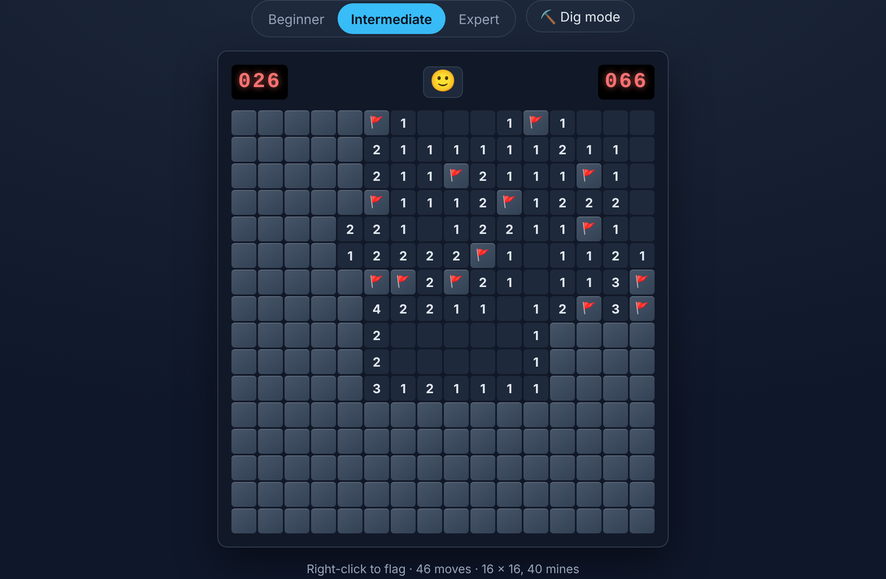
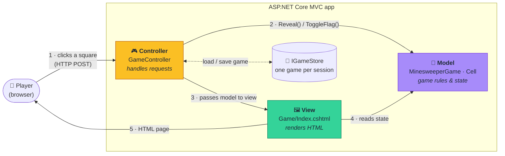
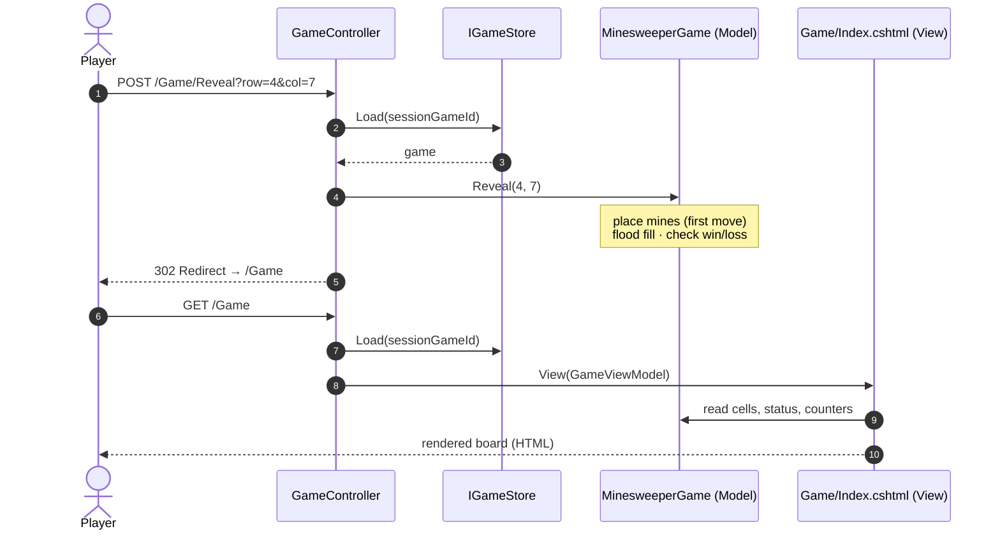
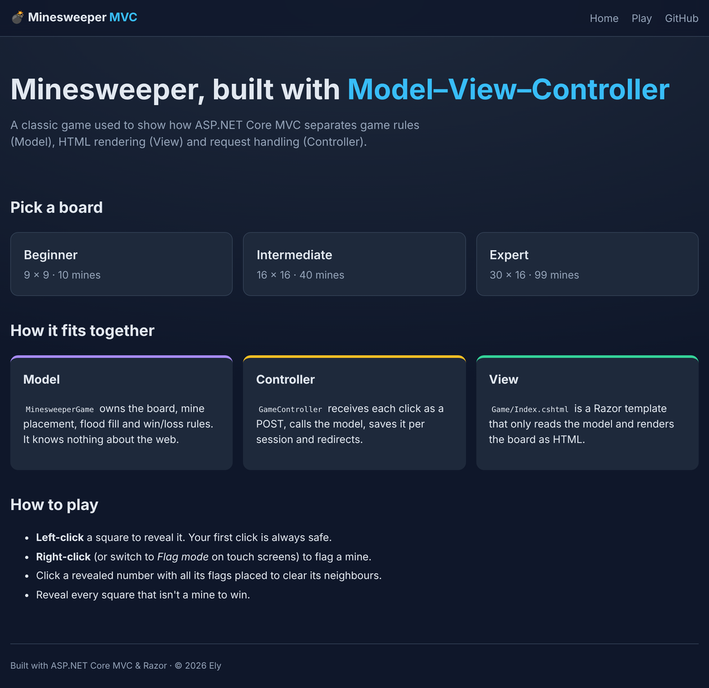

# 💣 Minesweeper MVC

[](https://github.com/Elyahu41/MinesweeperMVC/actions/workflows/dotnet.yml)


The classic Minesweeper game built with **ASP.NET Core MVC** and **Razor**. It started as my college final project for learning the **Model–View–Controller** pattern and has since been rebuilt on .NET 10 to show that separation more clearly.

<p align="center">
  
</p>

## ✨ Features

- **Three classic difficulties:** Beginner (9×9, 10 mines), Intermediate (16×16, 40 mines), Expert (30×16, 99 mines)
- **Safe first click:** mines are placed *after* your first move and never in the 3×3 area around it
- **Flood fill:** opening an empty square clears the whole empty region around it
- **Flagging:** right-click to flag, or switch to *Flag mode* on touch screens
- **Chording:** click a number whose flags are all placed to open all of its neighbours at once
- **Mine counter, timer and smiley reset button**, like the original game
- **One game per player:** each browser session gets its own game
- **Works without JavaScript:** every move is a plain HTML form post. JS only adds right-click and a live timer.

## 🧩 How MVC works in this project

The app is split into three layers, each with a single job:

| Layer | File | What it does |
|---|---|---|
| **Model** | [`Models/MinesweeperGame.cs`](MinesweeperMVC/Models/MinesweeperGame.cs) | Holds the board and **all** game rules: mine placement, flood fill, flags, chording, win/loss. Plain C# with no web code, so it is easy to unit test. |
| **View** | [`Views/Game/Index.cshtml`](MinesweeperMVC/Views/Game/Index.cshtml) | Razor template that **reads** the model and renders the board as HTML. It never changes game state. |
| **Controller** | [`Controllers/GameController.cs`](MinesweeperMVC/Controllers/GameController.cs) | Handles HTTP. It turns each click into a call on the model, saves the game for the player's session, and decides what to show next. |



### What happens on a single click

Every move follows the **Post/Redirect/Get** pattern, so refreshing the page never replays a move:



## 🖥️ Screenshots

| Home page | Game in progress |
|---|---|
|  |  |

## 🚀 Getting started

**Requirements:** [.NET 10 SDK](https://dotnet.microsoft.com/download/dotnet/10.0)

```bash
git clone https://github.com/Elyahu41/MinesweeperMVC.git
cd MinesweeperMVC
dotnet run --project MinesweeperMVC
```

Then open the URL shown in the terminal (for example `https://localhost:5001`). You can also open `MinesweeperMVC.sln` in Visual Studio or Rider and press **F5**.

### Running the tests

```bash
dotnet test
```

The MSTest suite covers the model (first-click safety, mine counts, flood fill, flags, chording, win/loss) and the controller (per-session games, flag mode, redirects). The tests run on every push through GitHub Actions.

## 📁 Project structure

```
MinesweeperMVC/
├── Controllers/
│   ├── GameController.cs      # Controller: game actions (New, Reveal, Flag, ToggleFlagMode)
│   └── HomeController.cs      # Landing page & error page
├── Models/
│   ├── MinesweeperGame.cs     # Model: board + all game rules
│   ├── Cell.cs                # One square on the board
│   ├── Difficulty.cs          # Beginner / Intermediate / Expert presets
│   ├── GameStatus.cs          # NotStarted, InProgress, Won, Lost
│   └── GameViewModel.cs       # Model + UI state passed to the view
├── Services/
│   ├── IGameStore.cs          # Abstraction for saving games
│   └── MemoryGameStore.cs     # In-memory, per-session implementation
├── Views/
│   ├── Game/Index.cshtml      # View: the board
│   ├── Home/Index.cshtml      # Landing page
│   └── Shared/_Layout.cshtml
├── wwwroot/                   # CSS + a small, optional JS file
└── Program.cs                 # App startup & dependency injection
MinesweeperMVC.Test/           # MSTest unit tests
```

## 🔄 What changed in the 2026 rewrite

The original 2021 version targeted .NET 5. The rewrite keeps the same idea but updates the code:

| 2021 | 2026 |
|---|---|
| .NET 5, `Startup.cs` | .NET 10, minimal hosting in `Program.cs`, nullable reference types |
| One `static` game shared by **every** visitor | One game per browser session, stored behind an `IGameStore` service |
| Cells stored as `Dictionary<string, int>` (`"Bomb"`, `"Active"`…) | Strongly typed `Cell` class and a `GameStatus` enum |
| The **View** decided win/loss and redirected | The **Model** owns win/loss and the view only renders it, which is proper MVC separation |
| Moves sent as GET links | POST forms with antiforgery tokens, using Post/Redirect/Get |
| Fixed 30×100 board, 150 mines | Classic Beginner / Intermediate / Expert presets |
| Win required flagging every mine | Standard rules: reveal every safe square |
| Recursive flood fill, `new Random()` in a loop | Iterative flood fill, Fisher–Yates mine placement, seedable `Random` for tests |
| Bootstrap 4 + jQuery template | Custom, dependency-free CSS with a dark theme |
| Tests depended on random mine layouts | Deterministic tests with seeded randomness, plus a CI workflow |

---

Made by [Ely](https://github.com/Elyahu41)
